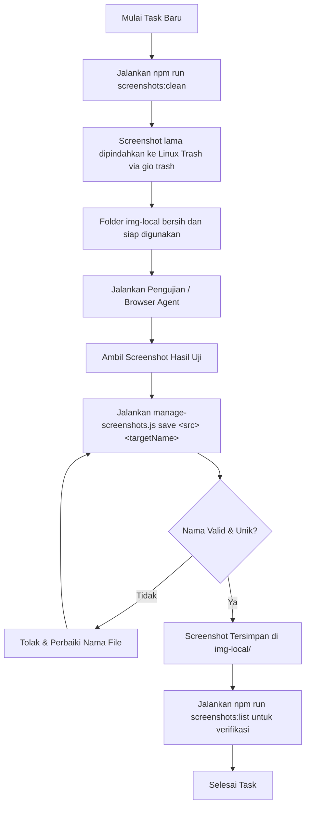

# MUSICFY Screenshot Management Guide

Sistem pengelolaan screenshot khusus untuk project MUSICFY, dirancang untuk pengujian UI/UX, browser inspection, responsive testing, dan visual verification.

---

## 1. Lokasi Folder Utama

Semua screenshot hasil pengujian Browser Agent, browser inspection, UI testing, responsive testing, dan visual verification **wajib** disimpan di:

```
img-local/
```

Lokasi absolut: `/home/shanz/Downloads/MUSICFY-main/img-local/`

> **PENTING**: Dilarang menyimpan screenshot pengujian baru di folder lain. Folder ini dilindungi oleh `.gitignore` (`img-local/*` dan `!img-local/.gitkeep`) agar file screenshot pengujian tidak membebani repository git.

---

## 2. Aturan Format Nama Screenshot

Setiap file screenshot harus memiliki nama unik, deskriptif, dan mengikuti pola segmentasi kebab-case:

```
phase-task-device-page-timestamp.png
```

### Syarat Penamaan:
- Minimal terdiri dari 4 segmen yang dipisahkan oleh tanda hubung (`-`).
- Segmen 1: Penanda phase project (contoh: `phase1`, `phase2`, `phase3`).
- Segmen tengah: Konteks pengujian, nama fitur/task, jenis perangkat (`desktop`, `mobile`, `tablet`), atau halaman (`home`, `library`, `search`, `settings`, dll.).
- Segmen akhir: Timestamp atau counter urutan numerik (contoh: `001`, `002`, `1731560000`).
- Ekstensi: `.png` (standar), `.jpg`, atau `.webp`.
- **Dilarang keras** menggunakan nama generik seperti `media_0.png`, `image.png`, `screenshot.png`, `screen.png`, `capture.png`, atau `test.png`.
- **Dilarang menimpa file** yang sudah ada dalam task yang sama. Selalu naikkan nomor urut counter (misal: `-001` menjadi `-002`).

### Contoh Nama File yang Valid:
- `phase1-gesture-mobile-home-001.png`
- `phase1-gesture-mobile-library-002.png`
- `phase1-desktop-home-003.png`
- `phase2-artist-section-mobile-001.png`
- `phase3-settings-desktop-001.png`

---

## 3. Mekanisme Pemindahan ke Recycle Bin / Trash

Ketika memulai task atau prompt baru, screenshot lama di `img-local/` dipindahkan ke OS Trash:

- **Perintah Resmi**: Menggunakan utilitas desktop Linux `gio trash <filepath>`.
- **Lokasi Trash Linux**: `~/.local/share/Trash/files/` dan `~/.local/share/Trash/info/`.
- **Larangan Keras**: **TIDAK PERNAH** menggunakan perintah hapus permanen (`rm`, `rm -rf`, `fs.unlinkSync()`, `fs.rmSync()`).
- **Integritas Folder**: Folder `img-local/` dan file penanda `.gitkeep` tidak pernah dihapus.
- **Fail-Safe**: Jika `gio` tidak tersedia atau operasi trash mengalami kegagalan, proses **wajib dihentikan (HALT)** dan dilaporkan kepada pengguna tanpa fallback ke `rm`.
- **Perlindungan Data Brain**: File screenshot asli yang tersimpan di direktori Antigravity Brain tidak pernah dihapus.

---

## 4. Perintah CLI / NPM Scripts

Script pengelola terletak di: `scripts/manage-screenshots.js`

### 1. Pindahkan Screenshot Lama ke Trash (Awal Task)
```bash
npm run screenshots:clean
# atau
node scripts/manage-screenshots.js clean
```

### 2. Simpan Screenshot Baru ke `img-local/`
```bash
node scripts/manage-screenshots.js save <path-sumber> <nama-file-tujuan>

# Contoh:
node scripts/manage-screenshots.js save /path/to/media_0.png phase1-desktop-home-001.png
```
Script akan:
1. Memvalidasi nama file tujuan sesuai format.
2. Memeriksa apakah file sudah ada (mencegah penimpaan).
3. Menyalin file ke `img-local/`.
4. Memverifikasi ukuran file > 0 byte.
5. Memastikan file sumber asli tidak tersentuh.

### 3. Validasi Format Nama File
```bash
node scripts/manage-screenshots.js validate <nama-file>
```

### 4. Daftar Screenshot Aktif
```bash
npm run screenshots:list
# atau
node scripts/manage-screenshots.js list
```

### 5. Cek Status Lingkungan
```bash
npm run screenshots:status
# atau
node scripts/manage-screenshots.js status
```

---

## 5. Workflow untuk Agent dan Pengembang

Ketika menjalankan task UI / browser testing:



---

## 6. Catatan Terkait Otomasi Prompt di Antigravity

Antigravity beroperasi sebagai conversational agent environment dan **tidak memiliki hook pemicu otomatis pre-prompt** (seperti shell hook atau git hook) untuk mengeksekusi script bash sebelum pengguna mengirimkan prompt.

Oleh karena itu, prosedur baku yang diterapkan adalah:
1. **Aturan Perilaku AI Agent (Workflow Instruction)**: Setiap kali AI Agent menerima task atau prompt baru yang melibatkan pengujian UI/visual/browser, langkah pertama yang wajib dijalankan oleh agent adalah memanggil `node scripts/manage-screenshots.js clean`.
2. **Ketersediaan Shortcut NPM**: Pengembang maupun agent dapat memanggil `npm run screenshots:clean` dengan mudah dan aman kapan saja.
